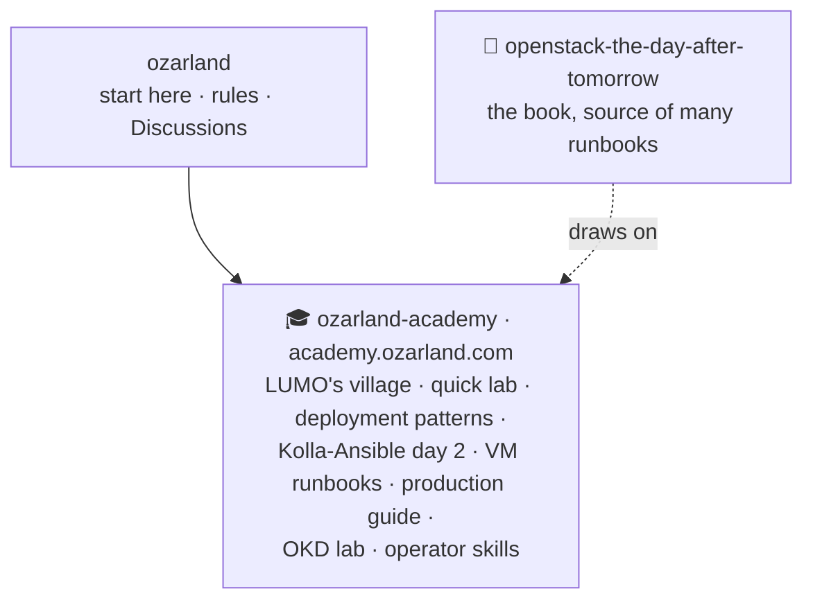
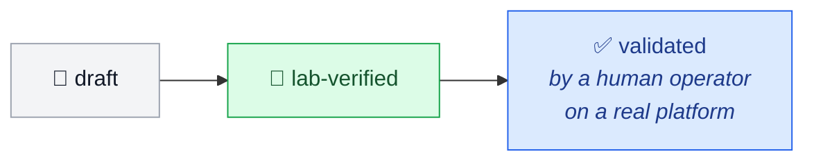

  
#  Welcome to OzarLand

**A shared land for better OpenStack operations.**

A community-driven space where OpenStack operators share what they learn running it: fixes, deployment choices,
experience. Early-stage, independent, open to everyone, whatever tool deployed your cloud.

  
  
  
  

---

## 🚪 Pick your door

| You are… | Go to |
|---|---|
| 🌱 **New to OpenStack** | [LUMO's village](https://academy.ozarland.com/village/): the basic concepts told as a story, then the [newcomer path](https://github.com/OzarLand/ozarland/blob/main/newcomers/README.md): five short pages, read in order |
| 🎓 **Learning step by step** | [OzarLand Academy](https://academy.ozarland.com/): one learning path, from a disposable lab to production and beyond |
| 🧪 **Want to try OpenStack** | [Quick lab](https://academy.ozarland.com/lab/): one VM, about one hour, one command to delete it |
| 🔧 **Fixing a problem with a VM** | [VM runbooks](https://academy.ozarland.com/runbooks/#index): find your symptom, follow the steps |
| 🏗️ **Deploying a platform** | [Deployment patterns](https://academy.ozarland.com/deploy/#index): how platforms are built with Kolla-Ansible, and what each choice implies |
| ⚙️ **Running Kolla-Ansible day to day** | [Kolla-Ansible Academy](https://academy.ozarland.com/day2/): what each day-2 command really does, studied from the source code, one study per release (Ussuri to 2025.1 Epoxy) |
| 🤖 **Using an AI assistant on call** | [Operator skills](https://academy.ozarland.com/skills/): Claude skills that apply this knowledge and say how well each procedure was tested |
| 🤝 **Ready to contribute** | [Your first contribution](https://github.com/OzarLand/ozarland/blob/main/newcomers/first-contribution.md): start with ten minutes |

💬 A question? [Start a discussion](https://github.com/OzarLand/ozarland/discussions).

## 🗺️ How the repositories fit together

| Repository | What it holds |
|---|---|
| 🏠 [ozarland](https://github.com/OzarLand/ozarland) | Start here: the newcomer path, the community rules, the templates, the [Discussions](https://github.com/OzarLand/ozarland/discussions) |
| 🎓 [ozarland-academy](https://github.com/OzarLand/ozarland-academy) | **[OzarLand Academy](https://academy.ozarland.com/)**, the whole learning path in one repository and one site |
| 📖 [openstack-the-day-after-tomorrow](https://github.com/OzarLand/openstack-the-day-after-tomorrow) | [*OpenStack, the Day After Tomorrow*](https://book.ozarland.com/), a free book on operating mission-critical OpenStack platforms |

📦 `openstack-quick-lab`, `kolla-ansible-deployment-patterns`, `openstack-vm-runbooks`, `production-guide`,
`kolla-ansible-academy`, `okd-openstack-lab`, `openstack-upgrade-journeys` and `openstack-operator-skills` moved,
with their history, into `ozarland-academy` in November 2026. They are archived (read-only) and their README points
to the new place. [Current repositories](https://github.com/OzarLand/ozarland/blob/main/docs/repositories.md#current-repositories)

## 🔬 Every page says how much it was checked

Pages are written and lab-tested with AI agents, and validated only by human operators. Nothing is `validated`
yet: read every page as a well-documented lead, not as a proven procedure.
[Live status](https://github.com/OzarLand/ozarland#-project-status) ·
[How OzarLand is built](https://github.com/OzarLand/ozarland/blob/main/docs/how-ozarland-is-built.md)

## 🙌 How you can help

| | |
|:-:|---|
| ✅ | Run a page on your platform and say what happened |
| 🛠️ | Share a problem you solved |
| ❓ | Ask the question you could not find answered |

🌱 OzarLand started as a personal initiative by Soufian Zaouam to share practical OpenStack operational knowledge.
It is free, and meant to grow into a space where operators help each other run more reliable platforms: your
knowledge, feedback and contributions are welcome. Felcloud, OzarLand's first sponsor, provides the cloud credit
for the labs and has no say over the content.
[Where OzarLand comes from](https://github.com/OzarLand/ozarland#-where-ozarland-comes-from)

OzarLand is an independent community initiative, not affiliated with or endorsed by the OpenInfra Foundation or
any vendor. Content under the Apache License 2.0.
