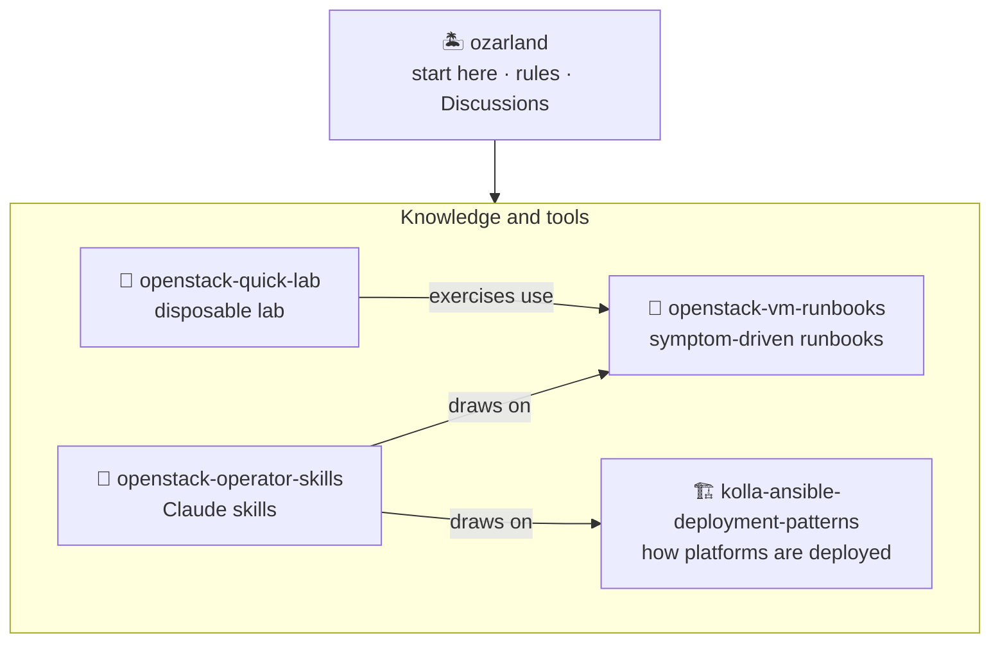
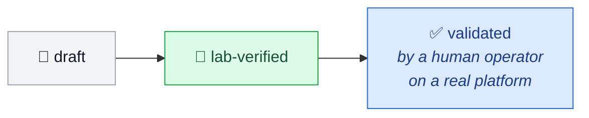

# 🏝️ Welcome to OzarLand

**What OpenStack operators learn running it: fixes, deployment choices, experience.**

An early-stage, independent space, open to everyone, whatever tool deployed your cloud.

  
  
  
  

---

## 🚪 Pick your door

| You are… | Go to |
|---|---|
| 🌱 **New to OpenStack** | [Newcomer path](https://github.com/OzarLand/ozarland/blob/main/newcomers/README.md): five short pages, read in order |
| 🧪 **Want to try OpenStack** | [openstack-quick-lab](https://github.com/OzarLand/openstack-quick-lab): one VM, about one hour, one command to delete it |
| 🔧 **Fixing a problem with a VM** | [VM runbooks](https://github.com/OzarLand/openstack-vm-runbooks#index): find your symptom, follow the steps |
| 🏗️ **Deploying a platform** | [Deployment patterns](https://github.com/OzarLand/kolla-ansible-deployment-patterns#index): how platforms are built with Kolla-Ansible, and what each choice implies |
| 🤖 **Using an AI assistant on call** | [openstack-operator-skills](https://github.com/OzarLand/openstack-operator-skills): Claude skills that apply this knowledge and say how well each procedure was tested |
| 🤝 **Ready to contribute** | [Your first contribution](https://github.com/OzarLand/ozarland/blob/main/newcomers/first-contribution.md): start with ten minutes |

💬 A question? [Start a discussion](https://github.com/OzarLand/ozarland/discussions).

## 🗺️ How the repositories fit together

## 🔬 Every page says how much it was checked

Pages are written and lab-tested with AI agents, and validated only by human operators. Nothing is `validated`
yet: read every page as a well-documented lead, not as a proven procedure.
[Live status](https://github.com/OzarLand/ozarland#-project-status) ·
[How OzarLand is built](https://github.com/OzarLand/ozarland/blob/main/docs/how-ozarland-is-built.md)

## 🙌 How you can help

| | |
|:-:|---|
| ✅ | Run a page on your platform and say what happened |
| 🛠️ | Share a problem you solved |
| ❓ | Ask the question you could not find answered |

OzarLand is an independent community initiative, not affiliated with or endorsed by the OpenInfra Foundation or
any vendor. Content under the Apache License 2.0.
